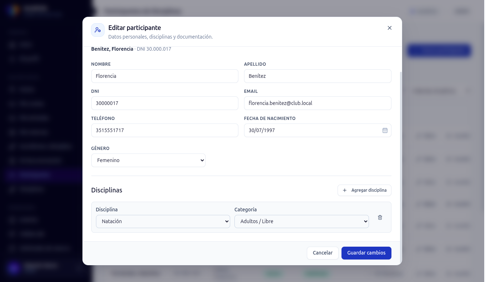

# Revisión de hallazgos de la daily — 14/11/2026

Puntos: `/participantes`, entradas QR, documentación y otros bugs del mismo estilo.

**Cómo se revisó:** se recorrió la API y el front locales con dos usuarios, admin y colaborador (`franco.bustos`), y se leyó el código.
Los puntos marcados *(código)* no se reprodujeron en el navegador, para no ensuciar la base local. Se confirmaron leyendo el código.

> Rutas: `front/` = `socialclub-frontend`, `back/` = `socialclub-backend`.

> **Actualización 15/11/2026.** El punto 7 y el D quedaron cerrados: `validarAcceso` recibe el evento, rechaza el de otro evento y el de un evento cancelado sin cambiar el estado de la entrada. El resto de esta lista no se reabrió.

## Hallazgos de la daily

| # | Qué está mal | Qué corregir |
|---|---|---|
| 1 | **Inscribir y Editar son dos modales distintos.** Hacen lo mismo con código duplicado (`InscripcionForm.tsx` y `EditarParticipanteModal.tsx`). | Unificarlos en un solo modal, "Editar participante", con la lista de disciplinas. Quitar el botón "Inscribir" de la fila. |
| 2 | **El tachito borra la disciplina en el momento** *(código)*. `handleEliminarDisciplina` llama al `DELETE` sin pedir confirmación (`front/src/features/inscripcion/components/EditarParticipanteModal.tsx:174`). Si después se aprieta "Cancelar", la disciplina ya quedó eliminada. | Pedir confirmación con `ConfirmDialog` y marcar la fila como "a eliminar". El `DELETE` se manda recién al tocar "Guardar cambios". |
| 3 | **"Nuevo participante" admite una sola disciplina.** El schema del front y `CreateInscripcionDto` del back tienen un único `disciplinaId`. | Formulario con una lista de disciplinas, igual que en editar. En el back alcanza con N `POST`, aunque lo ideal es un endpoint que reciba un array y lo grabe en una sola transacción. |
| 4 | **El tachito es gris y está desalineado** (queda unos 12 px más arriba que el select). No se ve rojo porque `cn()` usa solo `clsx`, sin `tailwind-merge`, y gana el gris de la variante `ghost`. Además se centra contra "label + select" en lugar de contra el select (`EditarParticipanteModal.tsx:496`). | Para el color, ver el punto A. Para la alineación: `sm:items-end` en la fila, o darle un label vacío al tachito.  |
| 5 | **Los colores de las acciones de la fila no se distinguen.** Todos los botones son grises, incluso "Dar de baja", que en el código está como rojo (punto A). | Botones solo con ícono y tooltip, con color según la acción: rojo = baja, verde = reactivar, gris = neutro. |
| 6 | **"Mis entradas" no tiene paginación, estado ni búsqueda.** Muestra todas las tarjetas con QR, aunque la API ya devuelve el `estado` (`front/src/features/entradas/pages/MisEntradasPage.tsx`). | Paginar en el back (`listarMisEntradas` hoy trae todo). Mostrar un badge Válida / Usada / Vencida. Las usadas y vencidas, en gris y sin descarga. |
| 7 | **La entrada se marca USADA aunque sea de otro evento** *(código)*. `validarAcceso` no recibe el evento que se está controlando, así que marca USADA y recién después el front avisa "evento incorrecto". Para entonces la entrada ya se consumió. | Agregar `eventoId` a `ValidarEntradaDto`. Si no coincide con el evento de la entrada, responder 409 **sin** cambiar el estado (`back/src/entradas/entradas.service.ts:222`). |
| 8 | **`/inscripcion` redirige a `/participantes?nueva=1`.** Es intencional (DT-11): la inscripción se fusionó en Participantes. | No es un bug. Eliminar la ruta legada o documentarla. |
| 9 | **El parámetro `nueva=1` en la URL.** Es intencional (DT-20): el modal se guarda en la URL para poder compartirlo y para que funcione "atrás". | Si molesta, pasarlo a estado local. Con el punto 1 desaparece. |
| 10 | **"Dar de baja" aparece en la pestaña Baja.** Se confirmó con un dato real: "qweqweq, 123ads" está en Baja pero figura Activo. Hay dos estados mezclados: la pestaña filtra por "sin inscripciones activas", mientras que los botones miran `persona.activo`. Se llega a este caso al borrar todas las disciplinas desde Editar. | Definir una sola regla. Propuesta: al eliminar la última disciplina, preguntar "¿dar de baja al participante?" y que la pestaña filtre por `persona.activo`. |
| 11 | **Inscribir → X: se cierra el modal, se abre otro y se cierra.** Confirmado. Los títulos que aparecen son: "Inscribir a Benítez" → "Nuevo participante" → (cerrado). React Router 7 aplica `setSearchParams` dentro de una transición, entonces `setAInscribir(null)` se dibuja antes. Con el modal todavía abierto cambian el título y el `key` del formulario (`front/src/features/inscripcion/pages/ParticipantesPage.tsx:80`). | En `cerrarInscripcion`, cerrar solo con la URL y limpiar `aInscribir` cuando el modal ya esté cerrado, no antes. |
| 12 | **Faltan buscadores** en `/cuotas/deportiva`, `/cuotas/social`, `/reportes/asistencia-eventos`, `/mis-entradas` y `/tareas`. El resto de los listados ya lo tiene. | Agregar el `Input` de búsqueda, igual que en Socios y Participantes. |
| 13 | **Documentación tras una baja y un alta** *(código)*. Los documentos quedan en la persona, y eso está bien. Los problemas: **a)** al reinscribir, `fechaInscripcion` vuelve a hoy y el plazo de tolerancia de los faltantes se reinicia, así que con una baja y un alta se esquiva un bloqueo; **b)** se reutiliza la misma fila de inscripción, entonces la habilitación excepcional "única" ya figura usada, y si sigue vigente se aplica sola; **c)** mientras el participante está inactivo no se le pueden cargar documentos. | A definir con el PO: **a)** conservar el plazo anterior; **b)** contar la excepción por período o anularla en la baja. Probarlo en el navegador antes de cerrar. |

## Otros bugs del mismo estilo

| # | Qué está mal | Qué corregir |
|---|---|---|
| A | **Los colores personalizados de `Button` no se aplican en ningún lado.** `cn()` no usa `tailwind-merge`, así que cualquier `className` de color pierde contra la variante. Afecta 13 botones en 11 archivos: Socios, Usuarios, Disciplinas, Categorías, Cuotas, Documentación, Comprar entradas, etc. Confirmado: "Dar de baja" se ve gris. | Usar `tailwind-merge` en `front/src/lib/utils/cn.ts` o pasar a las variantes `danger`/`success`. Corrige los 13 de una vez. |
| B | **El COLABORADOR ve "Editar" y el modal falla.** Confirmado: aparece "No se pudo cargar el participante", porque el back solo permite ADMIN y DELEGADO. | Ocultar "Editar" con la misma regla que `puedeInscribir`. |
| C | **"Registrar nuevo" no hace nada para el COLABORADOR** *(código)*. Pasa en Cobrar cuota deportiva y en Historial deportivo: navega a `/participantes?nueva=1`, pero como no puede inscribir, el modal no se abre (`front/src/features/pagos/pages/RegistrarPagoDeportivoPage.tsx:253`). | Ocultar esa acción para el COLABORADOR. |
| D | **Se acepta la entrada de un evento cancelado** *(código)*. `validarAcceso` solo verifica si el evento terminó, no si está `CANCELADO`. | Rechazarla si `evento.estado === 'CANCELADO'`, o vencer las entradas al cancelar el evento. |
| E | **"Guardar cambios" en Editar puede guardar a medias** *(código)*. Hace un `PATCH`/`POST` por disciplina, en secuencia y sin `try/catch` (`EditarParticipanteModal.tsx:233`). Si falla el segundo, el primero ya quedó grabado y el error no se muestra. Además: se puede agregar la misma disciplina dos veces, y "Agregar disciplina" aparece aunque el participante esté inactivo. | Un endpoint transaccional, o como mínimo `try/catch` con el error visible. Validar duplicados y deshabilitar "Agregar disciplina" si el participante está inactivo. |
| F | **La pestaña del modal de edición se mantiene entre participantes** *(código)*. Si se abre Documentación de uno y después se edita a otro, arranca en Documentación (`EditarParticipanteModal.tsx:53`). | Volver a "Datos" cada vez que se abre el modal. |

## Prioridad sugerida

1. **Afectan datos:** 7, 10, 2, D, E (entradas consumidas por error, bajas inconsistentes, borrados sin confirmar).
2. **Visuales y de permisos, de corrección rápida:** A, 11, B, C.
3. **Mejoras de UX:** 1, 3, 5, 6, 12, 13 (13 requiere decisión del PO).
